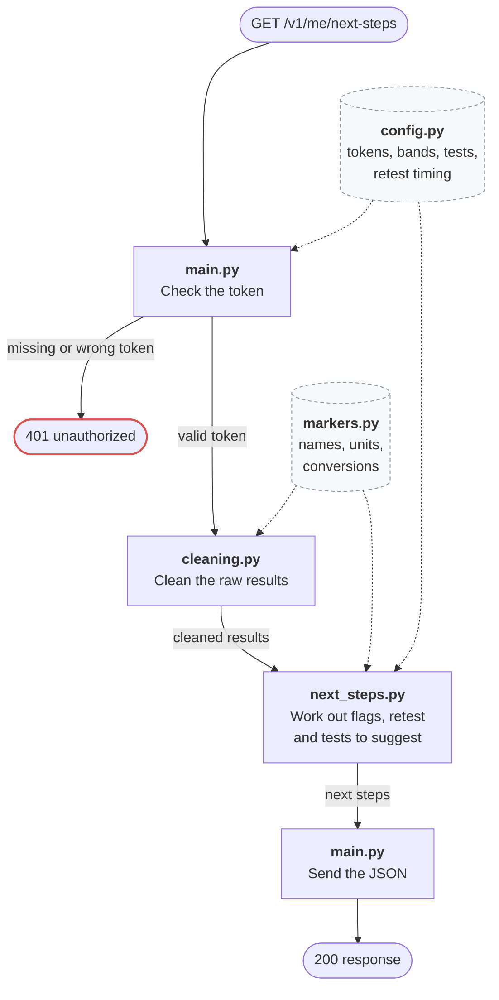
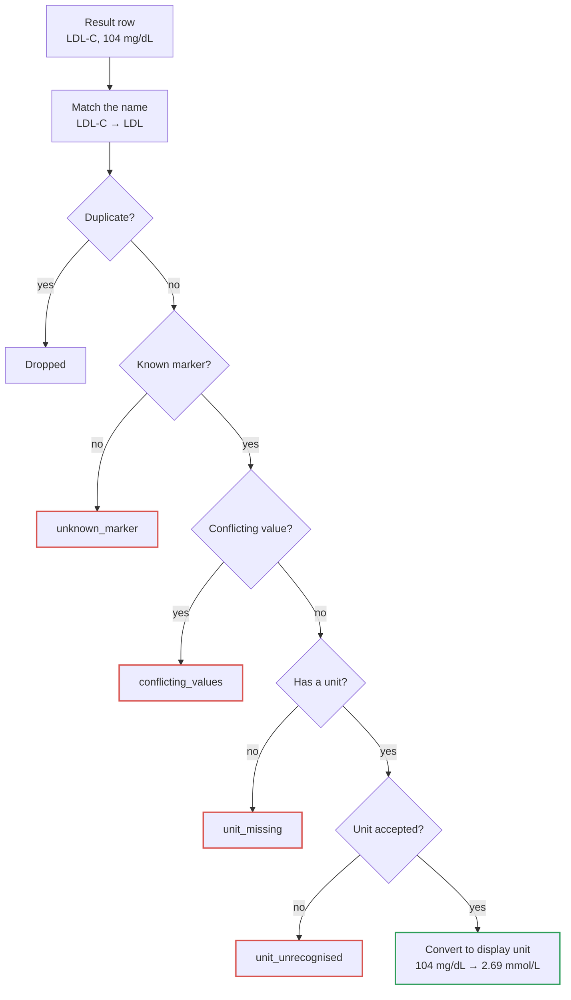
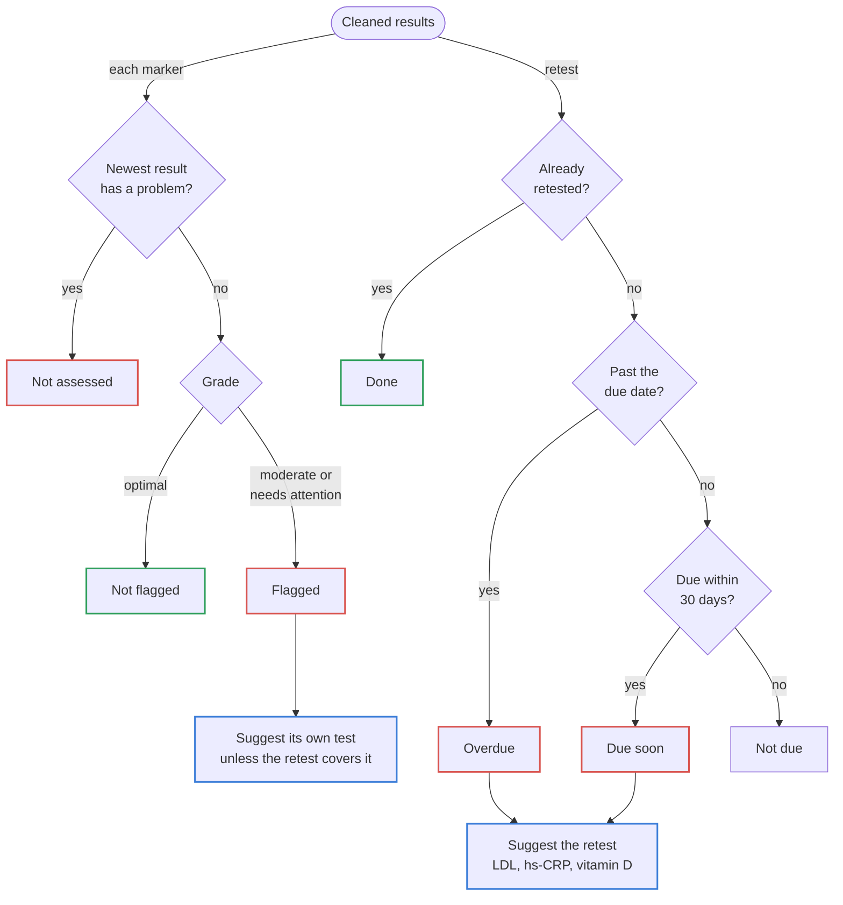

# Next Steps API

This is a small back-end for **Tests from your results** (the feature I ranked first). It reads a member's blood results and works out their next steps: which markers are flagged, whether their six-month retest is due, and which tests they can book at member price. Each suggested test comes with an add-to-cart action.

A big part of the work was cleaning Alex's data, which was quite messy (see [data issues](#data-issues)). Getting it right was crucial, as any minor mistake could flag a healthy marker / hide one that needs attention / suggest a test or protocol that nobody needs. And that's just one member's data, so with more examples, there will most certainly be other cases that need to be handled.

**Where to find each part of the task**

- Part 1 and 2, the ranking and why #1 came first: [docs/ranking.md](docs/ranking.md)
- Part 3, the back-end: this README and the code
- Part 3, the front-end sketch: [docs/frontend.md](docs/frontend.md), with a link to the clickable Figma prototype

Here's a trimmed version of what the API returns for Alex. His retest is overdue, five markers are flagged, and it suggests three tests. The unchecked upload is kept separate:

```json
{
  "retest": { "status": "overdue", "days_overdue": 42 },
  "flags": [
    { "name": "LDL Cholesterol", "value": 2.9 },
    { "name": "ApoB", "value": 0.92 },
    { "name": "hs-CRP", "value": 1.1 },
    { "name": "Vitamin D (25-OH)", "value": 68.0 },
    { "name": "Ferritin", "value": 205 }
  ],
  "suggestions": [
    { "name": "Six-month retest", "price_sgd": 180 },
    { "name": "ApoB add-on", "price_sgd": 45 },
    { "name": "Iron studies", "price_sgd": 60 }
  ],
  "total_sgd": 285,
  "unverified": [
    { "report": "U1", "review": "pending" }
  ]
}
```

The full response format is under [API](#api).

---

## Running it

Requires Python 3.11 or newer. To run the API locally:

### 1. Set up (once)

Open a terminal and go to the project folder (wherever you cloned or unzipped it):

```bash
cd path/to/this/folder
```

Create a virtual environment, a private folder for this project's libraries:

```bash
python3 -m venv .venv
```

Install the libraries into it:

```bash
.venv/bin/pip install -r requirements.txt
```

### 2. Start the server

```bash
.venv/bin/uvicorn app.main:app --reload
```

You should see `Uvicorn running on http://127.0.0.1:8000`. Leave this terminal open: the server runs until you press `Ctrl+C`, and it prints one log line for each request it gets.

### 3. Call the API

Open a second terminal and go to the project folder again (the first one is busy running the server):

```bash
cd path/to/this/folder
```

Then call the API:

```bash
curl -H "Authorization: Bearer demo-alex" localhost:8000/v1/me/next-steps
```

That prints the whole response on one line. For a readable, indented version, use this instead:

```bash
curl -s -H "Authorization: Bearer demo-alex" localhost:8000/v1/me/next-steps | python3 -m json.tool
```

You can also call it from a browser. With the server still running, FastAPI gives you an interactive docs page:

1. Open <http://localhost:8000/docs>.
2. Click **Authorize** (top right), type `demo-alex`, then click **Authorize** and **Close**.
3. Click **GET /v1/me/next-steps**, then **Try it out**, then **Execute**.

The formatted response appears below the button.

### 4. Run the tests

The tests don't need the server, so you can run them in any terminal that's in the project folder:

```bash
.venv/bin/python -m pytest
```

You should see `10 passed`. To list each test by name, add `-v`:

```bash
.venv/bin/python -m pytest -v
```

---

## Data issues

| In Alex's file | How it's handled |
| --- | --- |
| LDL is `LDL-C` in R2 and U1, `LDL Cholesterol` elsewhere | Treated as one marker, so R1–R3 form one trend |
| Vitamin D is `25 OH Vitamin D` in U1, `Vitamin D (25-OH)` elsewhere | Treated as one marker |
| HbA1c in `%` in R3 | Converted to 37.7 mmol/mol |
| hs-CRP listed twice in R3 | Duplicate dropped |
| Ferritin in `ug/L` | Read as µg/L |
| U1 upload still pending review | Shown separately, not used for flags, trends or suggestions |
| U1 LDL in mg/dL, vitamin D in ng/mL | Converted (104 → 2.7 mmol/L, 31 → 77.4 nmol/L) |
| U1 glucose has no unit | Unit isn't guessed, and it's never flagged |
| InBody, wearables, protocols, scores, age, sex, full name | Not used by this feature |

---

## How it works

### Stack

Python with FastAPI.

- FastAPI and Pydantic check `alex_lim.json` and the config files against typed models when the server starts, so a malformed file fails straight away. Also provides an interactive `/docs` page OOTB.
- Values are stored as decimals, so conversions and rounding are exact.
- Settings someone might change, like thresholds and prices, are in YAML so they can be edited without touching Python.
- pytest for testing. It keeps things simple with plain `assert`s, and FastAPI's test client can call the API without running the server.

### Project structure

```
app/
  main.py         The API: routes, demo login, privacy headers, logging
  records.py      Loads and validates alex_lim.json
  markers.py      Fixed facts per marker: names, display units, conversions
  config.py       Loads the adjustable settings from config/
  cleaning.py     Cleans the raw results and marks any it can't use
  next_steps.py   Grades markers, works out the retest, picks tests, builds the response

config/           Settings that change without touching code
  bands.yaml      Thresholds per marker (doctors would own this)
  tests.yaml      Tests, member prices, markers covered (product catalogue)
  retest.yaml     Retest timing: when it shows as due soon, how early it can be done
  tokens.yaml     The demo token, standing in for login

data/
  alex_lim.json   Alex's data, as-is from the brief
tests/            10 tests, mostly on data handling
docs/
  ranking.md      Part 1 and 2: the ranking and why #1
  frontend.md     Part 3: the front-end sketch and what it needs from the API
  assets/         Images used in the README (the time-spent bar)
```

### Request flow



More details can be found in the [data cleaning](#data-cleaning) and [deciding the next steps](#deciding-the-next-steps) sections below.

### Data cleaning

Each result row goes through these checks in order:



Rows with a problem (red) are still shown, but not used for flags or suggestions.

### Deciding the next steps

Flags and suggestions use our own tests and reviewed uploads. Pending uploads are left out (see [assumptions](#assumptions)).



---

## API

| Endpoint | Purpose | Auth | Errors |
| --- | --- | --- | --- |
| `GET /health` | Check the server is up | None | |
| `GET /v1/me/next-steps` | Everything the "Next steps" screen needs | Bearer token | `401` if the token is missing or wrong |

### Response fields for `/v1/me/next-steps`

| Field | What's in it |
| --- | --- |
| `member` | Preferred name only |
| `as_of` | The date the answer is for |
| `retest` | `status` (`done`, `overdue`, `due_soon`, `not_due`), the due date, and days overdue or until due |
| `flags` | Each flagged marker: value, unit, status, which report it came from, its trend over time, and the test that covers it |
| `not_assessed` | Markers we couldn't use, and why |
| `suggestions` | Tests to book: name, price, which flagged markers each covers, and an `add_to_cart` action |
| `total_sgd` | Sum of the suggested tests |
| `unverified` | Uploads still under review, each value shown with its original unit |

---

## Where the data comes from

Here it all comes from `alex_lim.json` and `config/`. In production:

| Data | Source |
| --- | --- |
| Test results | Lab results from core tests and retests |
| Uploads from other clinics | Member uploads, checked by our team |
| Retest due date | Membership system |
| Thresholds | Doctors' clinical rules |
| Tests and prices | Product catalogue |
| Who's asking | Member login |

## Privacy

Currently:

- Routes use `/me`, so members can only get their own data.
- The response only includes the member's preferred name, not their full name, age or sex.
- Member responses are sent with `Cache-Control: no-store`, so phones and browsers don't keep a copy.
- Logs only record the request ID, path, status and timing, not health values, names or tokens.
- Unexpected errors return a 500 with just a request ID, without any data or stack trace.

What I'd add in production:

- Real short-lived tokens from the member login.
- Encryption in transit and at rest.
- An audit log of who looked at each member's data.
- Data stored in Singapore, in line with PDPA.
- Notifications that don't mention a marker or value, since lock screens can be seen by anyone.

---

## Assumptions

- Uploads from other clinics are only used for flags and suggestions once our team has reviewed them. Until then they're shown separately.
- Markers are graded into the same three bands as the dashboard in the brief (optimal, moderate, needs attention). The last two are flagged.
- Thresholds, test names and prices in `config/` are made up.
- Grading uses the exact value. For display, each marker has a set number of decimals (e.g. LDL 2.9, ApoB 0.92, ferritin 205), and halves round up (2.65 → 2.7).
- Marker names match regardless of case, spaces, hyphens and brackets, and in units `u`, `µ` (U+00B5) and `μ` (U+03BC) are treated as the same.
- The six-month retest covers LDL, hs-CRP and vitamin D, so those don't get a separate test. Every other test covers one marker.
- One demo token stands in for login.

---

## What I'd do next

- More unit tests, especially for the data (e.g. conflicting values, missing markers, early retests), since its easy to get it subtly wrong.
- Map markers to standard [LOINC](https://loinc.org/) codes instead of hand-written name lists.
- A typed response model, so the `/docs` page shows exactly what the endpoint returns and the app has a clear contract to build against.

---

## Time spent

Probably about twice the 60 minutes.


## How I used AI

Data-wise, I inspected Alex's file by hand and used Claude Code to analyse it alongside, which caught a few issues I'd missed. I decided how each issue should be handled.

For the code, I decided the structure and wrote the boilerplate. Claude Code filled in the implementation against my specs, generated the Mermaid diagrams and helped tighten this README.

I reviewed every change and reworked / rejected suggestions where needed.